# Rodex interaction pipeline report

Rodex already separates local commands, model input, native tool policy, and
display-only notices. The key limitation is display placement: the existing notice
route keeps text out of model context, but **does not provide an ordinary inline
chat message**. On the installed Codex 0.162.1, both `warning` and
`deprecationNotice` appeared in the F2 warning center in an isolated native UI
probe on an idle initial screen. Neither appeared as inline conversation text.

This report covers `CODEX_TMUX_SESSION_MANAGER`, ALPHA version `0.15.0a1`, at
source revision `ed0c5dc`, inspected on 2026-10-11. It describes checkout defaults
and configuration contracts, rather than claiming to inventory effective settings
inside existing user sessions. A retained live runtime can use an older build.
The [architecture](ARCHITECTURE.md), [interaction guide](INTERACTION_PATHS.md), and
[prompt guide](PROMPT_SUBMISSION_FLOW.md) remain the detailed domain references.

## The complete interaction route

```mermaid
flowchart LR
    U[User terminal] <-->|tmux and outer PTY| G[TerminalSessionGateway]
    G <-->|child PTY| T[Native Codex TUI]
    T <-->|structured RPC| P[CodexProtocolProxy]
    P <-->|structured RPC| A[Codex App Server]
    A <-->|model requests and tool results| M[Model]
    G -->|local command intent| I[SessionInteractionPipeline]
    I -->|display-only MESSAGE| P
    I -->|explicit model MESSAGE| E[ExactTurnMutationCoordinator]
    E -->|control connection| P
    P -->|accepted primary events| V[Presentation, recovery, observer, analytics]
    A -->|PreToolUse Bash| H[Retained policy helper]
    H <-->|private policy socket| B[CommandPolicyBroker]
    B -->|transient display| S[TmuxStatusPipeline]
```



Invocation starts at the checkout `./rodex` shim or installed shim, then the
retained installation, CLI, and `UnifiedRodexApplicationPipeline`. Invocation
classification chooses local underscore commands, managed create/open/resume,
or unchanged native Codex delegation. A managed runtime has its own tmux server,
App Server, protocol proxy, native TUI, gateway, and registered identity. Native
passthrough is outside these managed interception routes.
[Routing source](../src/rodex/application_pipeline.py#L159),
[runtime composition](../src/rodex/runtime.py#L2560).

The native TUI starts with `--remote unix://<proxy-socket>`, `--no-alt-screen`,
`check_for_update_on_startup=false`, and `tui.animations=false`. Later explicit
Codex arguments can restore animations. The foreground terminal bridge transfers
its terminal descriptor and resize notifications to the daemon; the gateway is
the single owner of native input/output, even with several attached clients.
Codex still owns its composer, approvals, model conversation, and execution.
[Launch arguments](../src/rodex/runtime.py#L2847),
[bridge](../src/rodex/terminal_bridge.py),
[gateway](../src/rodex/terminal_gateway.py).

`SessionInteractionPipeline` applies **resolve → validate → transform →
revalidate → deliver → record**. Requests explicitly identify target, operation,
source, content, and whether a model turn is permitted. Hooks can change content
or reject delivery; they cannot change target, thread/turn identity, operation,
dispatch identity, or model permission. Outcome records are bounded metadata,
not a second transcript.
[Contract and execution](../src/rodex/interaction_pipeline.py#L68),
[hook constraints](../src/rodex/interaction_pipeline.py#L367).

This is a shared behavioral contract, not literally one Python object everywhere:
the daemon runtime shares one instance across its adapters; exact-control commands
and the observer renderer have their own instances. Native command policy has a
separate broker and returns its decision through Codex's native hook contract.
It does not rewrite tool requests in the protocol proxy.
[Exact-control adapter](../src/rodex/exact_turn_mutation.py#L323),
[policy composition](../src/rodex/runtime.py#L2626).

## What each kind of command means

| Intent | Current authoritative route | Effect on model context |
| --- | --- | --- |
| Type an ordinary prompt | Native composer → prompt admission → proxy → App Server | Submitted text becomes model input. |
| Type `/rodex light` or `/rodex dark` | Terminal interceptor → configured action → presentation policy | Local display selection only. |
| Type another native slash command or `!` shell escape | Native TUI handling | Depends on that native command; Rodex prompt rewriting does not own it. |
| Rewrite submitted prompt text | `UserPromptHook` and `protocol_input_text` | Changes model input. |
| Start or steer work programmatically | Exact mutation coordinator → `turn/start` or `turn/steer` | Real user input to a new or active turn. |
| Intercept an agent's shell command | Native `PreToolUse(Bash)` → helper → broker | Unchanged allow adds no Rodex feedback; a denial reason enters the native tool result and can reach model context. |
| Show a local notice | `main` MESSAGE with `start_model_turn=False` → downstream `warning` | No upstream model input. Native UI decides placement. |
| Show command-policy status | Broker → `CommandPolicyStatus` → tmux status owner | Display only; outside chat. |
| Rename a live session | Alias transition → `RODEX_AUTO_INFO` start/steer | An effective live rename attempts a real model message. |

The last row is an important variation: informational wording does not make an
operation display-only. A successful name change is retained even if its subsequent
model announcement fails.
[Alias behavior](../src/rodex/exact_turn_mutation.py#L240).

## How the Rodex screen works

The gateway decodes keyboard bytes, sends accepted input to the native child PTY,
and renders child output back to the outer terminal. `NativeTerminalProjection`
continually advances its native screen, including while Rodex shows an alternative
view. `TerminalSurfaceRenderer` composites local menus and semantic views without
feeding those frames back into the native screen or editor.
[Gateway delivery](../src/rodex/terminal_gateway.py#L329),
[surface rendering](../src/rodex/terminal_surface.py#L33).

`dark` is the default native Codex interface. `light` shows only root-thread
`agentMessage` items whose phase is `commentary`; it is a content filter, not a
color theme. Final answers, tool bodies, and child messages do not become light-view
transcript items. The native composer/control region remains available. Unknown
native modal states, including approvals, fall back to native rendering. Changing
the view does not change what Codex receives or executes.
[Policy definitions](../src/rodex/presentation_policy.py#L118),
[modal fallback](../src/rodex/terminal_surface.py#L121).

App Server output is delivered to its original client before primary-event
projections run. Only primary output feeds presentation, working/context indicators,
overload recovery, observers, analytics notifications, and the live event tap.
Control clients use separate upstream connections; their replies are not pasted
into the main screen. Local synthetic notices bypass these primary-event callbacks.
[Proxy ordering](../src/rodex/protocol_proxy.py#L1049),
[projection composition](../src/rodex/runtime.py#L2748).

The upper observer pane is a distinct, input-disabled view of tracked agents. Its
reducer owns running-agent state and exact request/turn correlation; framed snapshots
carry bounded display content. It opens while tracked agents are working and closes
when none remain. It is not a single model conversation to which a generic model
prompt can be addressed. `_cat`/`_tail` read terminal presentation; `_events` reads
protocol events; `_result` reads an exact turn. These are different observations.
[Observer implementation](../src/rodex/agent_observer.py#L313),
[observation contracts](CLI.md#observe-without-guessing-completion).

The tmux bar, terminal title, native chat area, warning center, local menu, and
observer pane are separate surfaces. In particular, the five-second command-policy
bar is not the mechanism for a user-only message inside the main chat area.

## What typing `/rodex` demonstrates

The registrations are Python configuration in
[input_interceptor_config.py](../src/rodex/input_interceptor_config.py#L95).
They define whole-input live matching, submitted-command matching, menu headings,
options, and typed actions. They are not loaded from the prompt-substitution YAML.

1. Typing a matching prefix, such as `/ro`, offers the matching `/rodex` and `/rodx`
   registrations only after Rodex verifies the already-forwarded native composer
   prefix and end cursor.
2. Rodex holds the remaining menu input locally. Up/down select cyclically; Tab
   completes the selected command. Enter opens its argument picker. Escape goes
   back from arguments or releases the command menu.
3. Selecting an argument and typing a complete configured command converge on the
   same `SUBMITTED_COMMAND` handler.
4. `light` and `dark` dispatch `SELECT_PRESENTATION_POLICY` to `presentation-policy`.
   `dusk` has no action and generates a display-only placeholder notice.
   `/rodx` has no argument options and generates a configuration-error notice when
   its picker is requested. Other matching but unconfigured `/rodex ARG` submissions
   are also placeholders, not arbitrary commands.
5. After accepted local handling, Rodex removes only the verified native prefix
   using DEL bytes. It does not send Enter to submit that command to the model.
   Unsupported editing in the command-completion stage restores held text as
   bracketed paste before returning control to Codex; the argument picker ignores
   unrelated edit/paste keys.

[Decoder/interceptor](../src/rodex/terminal_input.py#L201),
[menu state](../src/rodex/input_menu.py#L62),
[submitted handler](../src/rodex/input_interceptor_presentation.py#L63).

Configuration has a concrete limit: `ConfiguredInterceptionAction` currently carries
only `target`, `operation`, and `payload`; the adapter creates a request with that
payload. Adding a menu option that sends a MESSAGE needs an explicit adapter/contract
change to supply `text`, and a model action also needs explicit model permission.
Putting `MESSAGE` into the current option table alone will not implement either.
[Action fields](../src/rodex/input_interceptor_config.py#L13),
[action dispatch](../src/rodex/input_interceptor_presentation.py#L85).

## Prompt transformations and Enter handoff

For a verified ordinary native draft, the sequence is:

```text
hold Enter → verify original composer → transform text
  → edit the child PTY → drain/render output → verify canonical composer
  → admit a one-use receipt → release Enter
  → native structured request consumes receipt → App Server
```

Rodex edits through DEL and bracketed paste, using the native editor. It verifies
the rewritten screen before admitting the receipt. Confirmation has a 300 ms
handoff deadline with rechecks at up to 10 ms intervals; individual tmux operations
retain their own deadlines. A timeout keeps the rewritten text unsubmitted. A later
Enter retries confirmation without applying the transformation again. This is
rendered-state verification, not proof that every remote client painted the pixels.
[Handoff implementation](../src/rodex/terminal_input.py#L244),
[gateway confirmation](../src/rodex/terminal_gateway.py#L361).

The important route variations are:

- An initial managed argv prompt is prepared before launching the TUI and preserves
  initial whitespace. Native composer submission uses native trimming.
- An unchanged verified draft can admit its receipt without editing.
- An unverified draft reaches the structured protocol fallback. Model input is still
  transformed, but optimistic TUI history may show the original text.
- `_start`, `_steer`, `thread/queue/add`, and `thread/queue/update` transform structured
  text input. A control client cannot consume a primary-TUI preparation receipt.
- Attachments and non-text items, approval/settings fields, review/goal-specific
  fields, and internal child-agent traffic are outside this text rewrite contract.
- Native slash/shell input stays native. A verified text replacement cannot be empty,
  contain terminal controls, or acquire slash/shell-command meaning.

[Recognized RPCs and text handling](../src/rodex/protocol_input_text.py#L66),
[receipt consumption](../src/rodex/interaction_pipeline.py#L403).

Rules run sequentially. Named user rules replace identically named global rules in
place; new names append. Names are case-sensitive. `i`, `m`, `s`, and `g` are the
supported flags; without `g`, each rule replaces only its first match per text item.
Shipped rules include `Hello` → `Hello!` and a `push` workflow expansion; the
[YAML itself](../conf/hooks/user_prompt_substitutions.yaml) owns the exact text.
Legacy sed-like string rules are also accepted. Empty user YAML adds no overrides;
it does not disable global rules.
[Loading and merge behavior](../src/rodex/user_prompt_hook.py#L107).

The runtime re-stats rule files on submission, not on a polling timer. Metadata
fingerprints control reloads; invalid/unreadable/unstable files reject the submission
instead of silently using old rules. A corrected user file takes effect on another
submission without restarting the runtime. Protocol rewrites preserve other RPC
fields and adjust UTF-8 annotation offsets; annotations overlapping changed text
are removed.
[Reload behavior](../src/rodex/user_prompt_hook.py#L195),
[annotation handling](../src/rodex/protocol_input_text.py#L94).

## Injecting real model input

Within the composed runtime, the explicit operation is:

```python
result = interaction_pipeline.send_message(
    target="main",
    text="Continue...",
    start_model_turn=True,
    source="my-runtime-operation",
    dispatch_id="my-unique-dispatch-id",
)
```

This is a model submission, not terminal typing. Runtime composition verifies the
registered main thread, then calls `ExactTurnMutationCoordinator.start`. The
coordinator resolves and locks the session, re-resolves identity, and revalidates
before the control RPC. `CodexControlClient` accepts start only for `idle` or
`systemError`, unless direct input is explicitly refused. An active turn requires
the separate exact-turn steer operation.
[Runtime adapter](../src/rodex/runtime.py#L2476),
[mutation coordinator](../src/rodex/exact_turn_mutation.py#L98),
[start/steer RPCs](../src/rodex/control.py#L254).

The existing external CLI forms are:

```bash
rodex _inspect SESSION --json
rodex _start SESSION --dispatch DISPATCH_ID --stdin --json < prompt.txt
rodex _steer SESSION --turn TURN_ID --dispatch DISPATCH_ID --stdin --json < prompt.txt
rodex _dispatch-status SESSION --dispatch DISPATCH_ID --json
rodex _wait SESSION --turn TURN_ID --json
rodex _result SESSION --turn TURN_ID --json
rodex _interrupt SESSION --turn TURN_ID --json
```

These are independent command forms, not a sequence to run blindly. Dispatch IDs
support acceptance reconciliation; they are not a promise that repeating a request
is idempotent. A lost response can mean the mutation happened. Observe its dispatch
status before deciding what to do next. Approval/user-input requests remain with
the subscribed primary TUI.
[CLI grammar](../src/rodex/command_contract.py#L100),
[automation workflow](../.agents/skills/rodex-session-control/SKILL.md).

Native App Server offers `turn/start`, `turn/steer`, and `turn/interrupt`; steering
uses the expected active turn ID. It also documents `command/exec` for running a
command without starting a model turn. Rodex does not currently expose a matching
managed `_exec` route. Nor does it expose a generic API for executing arbitrary
TUI slash commands. These should not be confused with submitting prompt text.
[Official App Server documentation](https://learn.chatgpt.com/docs/app-server),
[Rodex command inventory](../src/rodex/command_contract.py).

## How overload recovery uses this pipeline

`ServerOverloadedRecoveryController` consumes primary protocol events. It binds
the registered main thread and reacts only to `turn/completed` with a failed turn
whose `error.codexErrorInfo` is exactly `serverOverloaded`. It does not match error
prose, a child thread, or a nonterminal retry notification.
[Trigger](../src/rodex/server_overloaded_recovery.py#L133).

It schedules `Continue...` as a `main` MESSAGE with `start_model_turn=True`, an exact
expected thread, and dispatch identity
`rodex:server-overloaded:<thread>:<failed-turn>`. This returns through the same
registered model adapter and exact-control path. It neither sends tmux keystrokes
nor impersonates a display-only message. The resulting structured prompt also
passes through the runtime's prompt rules.
[Scheduled request](../src/rodex/server_overloaded_recovery.py#L270).

The delay starts at 30 seconds and doubles for qualifying failures observed within
300 seconds, capped at 960 seconds. A larger gap resets to 30 seconds. **The gap
includes time spent waiting to retry.** Consequently, a serial failure after a
480-second wait resets if no intervening failure was observed; the configured cap
does not guarantee a monotonically increasing sequence of serial retries.
[Backoff calculation](../src/rodex/server_overloaded_recovery.py#L220),
[boundary tests](../tests/test_server_overloaded_recovery.py#L366).

Terminal input, primary disconnect, closure, root rebinding, or a newer qualifying
failure cancel or supersede pending work. Cancellation is rechecked after hooks,
lock waits, and transport setup at atomic dispatch admission. After admission it
cannot revoke the submitted request. An arbitrary external control request is not
itself the terminal-input cancellation signal; start still checks thread state at
dispatch. Recovery logs scheduling/cancellation/outcome metadata; it does not
currently publish a user-facing countdown notice. There is no exposed YAML/CLI
recovery toggle in this implementation.
[Cancellation/admission](../src/rodex/server_overloaded_recovery.py#L146),
[final runtime guard](../src/rodex/runtime.py#L2493).

## Intercepting native shell commands

The execution path is:

```text
Codex chooses a shell/unified-exec call
  → native PreToolUse matcher ^Bash$
  → retained Python helper receives native hook JSON
  → per-runtime policy socket and broker
  → decision on helper stdout
  → native Codex approvals, sandbox and execution
```

The request includes runtime/session/turn/cwd, permission mode, original tool input,
and normalized command text. The broker is bound to the exact App Server process
tree. The helper socket is passed to App Server, not the remote TUI. The broker
responds before queuing the transient tmux status.
[Broker contract](../src/rodex/command_policy.py#L71),
[decision delivery](../src/rodex/command_policy.py#L256).

Current production policy denies an exact integer `sleep N` when `N` is below 10;
other commands receive an unchanged allow, which writes no hook stdout. Typed deny
and command-rewrite decisions have native tests, while no rewrite rule is enabled in
production. Deny returns native denial JSON; rewrite supplies `updatedInput`,
preserving every original tool field except `command`. Rodex does not execute the
command itself or override native permission selection. Denial reasons and changed
tool results can be model-visible;
only the current silent allow and separate status display are context-neutral.
[Policy default](../src/rodex/command_policy.py#L180),
[native response mapping](../src/rodex/command_policy_hook.py#L24),
[native behavioral tests](../tests/test_command_policy_native.py#L64).

Startup probes `hooks/list` and effective configuration. A trusted exact Rodex hook
runs normally. When that exact hook is untrusted and is the sole enabled hook, Rodex
adds Codex's invocation-local trust bypass to the remote TUI; it does not persist
trust. Any other enabled hook retains `rodex _policy-setup` as the route for reviewing
and trusting Rodex through `/hooks`. Explicit caller/effective bypass remains native
intent, while explicit false prevents automatic bypass. If support or the exact
definition cannot be verified, Rodex restarts only its provisional App Server without
its own hook injection and continues with inactive status. The pre-thread inventory
is not locked against a same-user hook-file change before `thread/start`. Existing
native hooks remain under Codex composition. Hook failures are advisory/fail-open,
whereas invalid prompt YAML fails closed for submission.
[Trust admission](../src/rodex/command_policy_configuration.py),
[startup fallback](../src/rodex/runtime.py).

The `Bash` matcher covers shell and unified-exec command initiation. It does not
make `write_stdin` a new command interception, cover hosted web tools, or add Rodex
policy to `apply_patch` and MCP calls. Codex offers additional native hook events
and matchers, but this Rodex registration only installs `PreToolUse(^Bash$)`.
Native `systemMessage` hook output is warning UI/event output; `additionalContext`
adds model context and is unsuitable for a context-free notice.
[Hook registration](../src/rodex/command_policy_configuration.py#L30),
[official hook semantics](https://learn.chatgpt.com/docs/hooks).

## Sending a user-only notice and the inline-chat gap

The current internal call is:

```python
result = interaction_pipeline.send_message(
    target="main",
    text="Rodex: local operation finished.",
    start_model_turn=False,
    source="my-runtime-operation",
)
```

For a verified external caller, `publish_session_interaction` transports that typed
request to `/rodex-interaction`; `publish_tui_notice` is the existing convenience
wrapper. These require the correct runtime peer identity and proxy socket. They
are Python APIs, not a currently exposed `_notice` shell command. The endpoint
allows messages and pane operations, not arbitrary protocol frames or PTY bytes.
[Notice transport](../src/rodex/interaction_transport.py#L28),
[endpoint whitelist](../src/rodex/interaction_transport.py#L127).

The proxy resolves `main`, checks its primary connection binding, and sends only:

```json
{"method":"warning","params":{"threadId":"<main-thread>","message":"Rodex: local operation finished."}}
```

This goes directly downstream to the primary TUI. No App Server connection is
opened for the interaction endpoint, no `turn/start` is sent, and the notice is not
published to observer/analytics callbacks. The native screen bytes can still be
visible to terminal capture. `DELIVERED` means transport acceptance, explicitly
not confirmed rendering; no primary connection means delivery fails. Notices have
no Rodex durable replay queue or conversation record.
[Downstream delivery](../src/rodex/protocol_proxy.py#L1134),
[isolation test](../tests/test_rodex_protocol_proxy.py#L393).

This is already used for update notices, prompt-hook errors, handoff timeout
notices, and `/rodex` placeholder/configuration feedback. It is separate from
command-policy status in tmux.
[Menu notices](../src/rodex/input_interceptor_presentation.py#L95),
[prompt notices](../src/rodex/terminal_input.py#L267),
[attach notice](../src/rodex/runtime.py#L1909).

The isolated native probe on Codex 0.162.1's idle initial screen established:

| Injected downstream notification | Main screen before F2 | F2 display | Model requests |
| --- | --- | --- | --- |
| `warning` with exact thread ID and message | Warning indicator; message absent inline | Message in warning center, category Startup | 0 |
| `deprecationNotice` with summary and details | Warning indicator; message absent inline | Summary/details in warning center, category Deprecation | 0 |

After Escape, the deprecation message was absent from the ordinary screen.
Recorded upstream client frames contained neither injected text nor a
`turn/start`, `turn/steer`, or queue submission. `thread/start` did create the empty
fixture thread; that is distinct from starting a model turn. Existing managed
startup tests also deliberately accept either inline warnings or F2 presentation,
so they never established guaranteed inline placement.
[Existing native warning assertion](../tests/test_managed_startup.py#L380).

The probe used the repository's isolated offline
[native fixture](../tests/command_policy_native_fixture.py) and
[terminal client](../tests/test_managed_startup.py), plus a transparent recording relay
and the real remote TUI. It did not run through the full managed tmux/gateway or
characterize placement during an active turn.
`thread/read(includeTurns=true)` returned `list_turns is not supported yet`, so
this probe did not establish persisted transcript contents or restart behavior.
The existing proxy isolation test separately establishes that Rodex notices never
reach App Server. In `light`, notices are not semantic commentary items and bypass
presentation callbacks; the semantic transcript therefore has no local-notice
entry even when native warning controls remain accessible.

**The requested inline, context-free chat notice needs an explicit display feature.**
A coherent extension would keep typed display-only intent in the interaction
pipeline, add a Rodex-owned local-notice item to presentation state, and make the
surface renderer display it with clear Rodex attribution. It needs defined behavior
in both native and light views, while editing, after resize, on detach/reconnect,
and on runtime restart. Native view integration is real renderer work; adding a
light selector alone cannot supply it. A notice retention policy must be explicit.

Use the existing warning path when F2 placement is acceptable. Neither switching
to `deprecationNotice` nor returning hook `systemMessage` establishes the required
inline behavior. Fabricating assistant/user protocol items, using a hidden model
prompt, or appending arbitrary terminal output would not provide the same honest
display-only contract. A future implementation should add an owned presentation
route and update the existing effect inventory rather than bypassing its owners.
[Presentation owner](../src/rodex/presentation_policy.py#L199),
[effect audit](../tests/adversarial/test_interaction_path_ownership.py).

## Configuration map

| Configuration | Authority | When it takes effect |
| --- | --- | --- |
| Local slash registrations, headings, options, actions | `INPUT_INTERCEPTORS` in `input_interceptor_config.py` | Python implementation/runtime creation. No user-YAML menu loader. |
| Native/semantic display selection | `PRESENTATION_POLICIES`; `/rodex light` or `/rodex dark` | Selection changes the live runtime view. Initial policy is dark. |
| Global prompt rules | Retained `conf/hooks/user_prompt_substitutions.yaml` | Runtime submission cache; checkout edits affect a subsequent retained implementation. |
| User prompt overrides | `$XDG_STATE_HOME/rodex/conf/hooks/user_prompt_substitutions.yaml`, otherwise `~/.local/state/rodex/conf/hooks/user_prompt_substitutions.yaml` | Path frozen from launch environment; changed file metadata reloads on submission. |
| General content hooks | `SessionInteractionPipeline(hooks=...)` | Python composition. Production runtime explicitly composes the prompt hook, not a user-configured generic hook list. |
| Overload retry text/timing | Constants in `server_overloaded_recovery.py` | Implementation change; no exposed runtime setting. |
| Shell-command policy | `evaluate_command_policy`, injected `PreToolUse(^Bash$)`, exact inventory and native trust/configuration | Fresh managed runtime; Rodex-only untrusted inventory gets invocation-local bypass. |
| Command-policy bar | Policy adapter plus launcher handoff; shared `TmuxStatusPresentation.message`, `TimedStatusPublisher`, and `TmuxStatusPipeline.publish_timed` own rendering and five-second expiry | Lower-priority tmux claim; every expiry restores only its exact token, prefix mode remains visible, and active admission clears stale inactive state. |
| Native animations and other Codex options | Codex configuration/argv, with Rodex launch defaults | Native configuration semantics; animations can be explicitly restored. |
| Catalog, runtime endpoints, retained builds | `XDG_STATE_HOME`, `RODEX_RUNTIME_DIR`, `RODEX_INSTALLATIONS_ROOT` | Separate state/runtime/implementation domains; identity must match the selected session. |
| Update notice | `CodexUpdateNotice` and attach callback | Read-only lookup cached for 24 hours; display failure does not block attachment. |

[Prompt configuration](PROMPT_SUBMISSION_FLOW.md#rule-files),
[runtime locations and terminal settings](OPERATIONS.md),
[retained-runtime behavior](RUNTIME_ISOLATION.md#retained-runtime-upgrade).

## Verification and practical boundaries

The source review was independently repeated by a second agent, then reconciled
against the code and native probe captures. The primary reviewer checked the probe
payloads, output, and implementation rather than treating its summary as proof.

- **654 tests passed** across current/command contracts, interaction
  pipeline/integration, interceptor/menu behavior, terminal input/gateway/composer,
  presentation, prompt hooks, protocol proxy, exact control, overload recovery,
  policy/configuration/status, and the interaction effect audit.
- **14 native command-policy tests passed** using the installed Codex 0.162.1 and
  offline deterministic model fixture. They exercise allow, future deny/rewrite,
  native security, trust/disabled/bypass variations, and separate managed sessions.
  Python emitted five `forkpty()` multithreading deprecation warnings; no tests failed.
- The separate display probe copied no user authentication files, made no real
  model request, and did not touch an existing user session. Both tested native
  notice variants required F2 on the idle initial screen.

Validation used tmux 3.2a and Python 3.12. The project admits stable App Server
0.151.0 or newer; optional hook availability is separately probed. Newer version
admission does not promise that every future native UI will render notices alike.
The quota-using live prompt-handoff suite and full clean-installation suite were not
run for this documentation investigation. No production behavior was changed.
[Version contract](../src/rodex/app_server_contract.py),
[validation guide](DEVELOPMENT.md).
